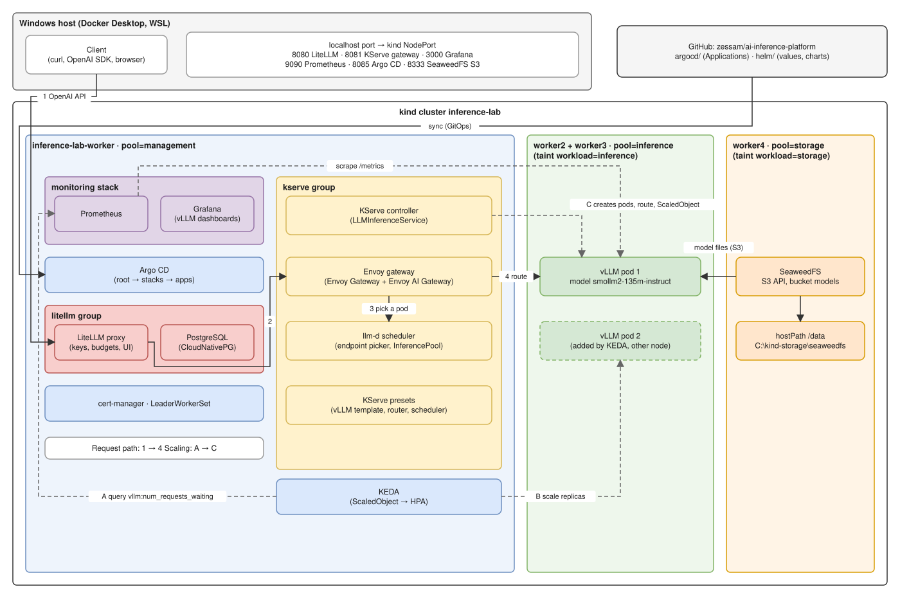

# ai-inference-platform

This repository runs a small LLM inference platform on a local kind cluster on Windows. vLLM serves the model. KServe deploys vLLM, and llm-d routes each request to the best vLLM pod. If requests wait in the queue, KEDA adds vLLM pods. LiteLLM gives clients one OpenAI-compatible API with keys and a UI. Argo CD deploys everything from this repository.

The lab runs on CPU with a small model (SmolLM2 135M). The same charts and Applications are meant for GPU nodes and large models. Only the values change.

## Architecture



The diagram is a draw.io file. To change it, open `docs/diagrams/architecture.drawio.svg` or `docs/diagrams/architecture.drawio` in draw.io.

The kind cluster `inference-lab` has one control-plane node and four worker nodes. A node pool is a group of nodes with the same label `pool`. A taint keeps pods off a node unless they tolerate it.

| Node | Pool | Taint | What runs there |
| --- | --- | --- | --- |
| inference-lab-worker | management | none | Argo CD, monitoring, KEDA, KServe, Envoy gateway, llm-d scheduler, LiteLLM, PostgreSQL |
| inference-lab-worker2, inference-lab-worker3 | inference | workload=inference | vLLM pods only |
| inference-lab-worker4 | storage | workload=storage | SeaweedFS only |

### Request path

A chat request goes through four steps:

1. The client sends an OpenAI API request to LiteLLM on `http://localhost:8080`.
2. LiteLLM sends it to the Envoy gateway of KServe.
3. Envoy asks the llm-d scheduler which vLLM pod to use. The scheduler prefers a pod that already holds the start of the prompt in its cache, and then the pod with the least load.
4. Envoy sends the request to that vLLM pod, and the answer goes back the same way.

### Autoscaling

KServe manages the scaling, and KEDA does the work:

1. The KServe controller creates a KEDA ScaledObject from the `scaling` section of the model.
2. KEDA reads the vLLM metric `vllm:num_requests_waiting` from Prometheus every 15 seconds.
3. KEDA sets the number of vLLM pods through an HPA (HorizontalPodAutoscaler), from 1 to 2.

When more than 2 requests wait, a second vLLM pod starts on the other inference node. About 5 minutes after the queue is empty, it goes away.

### Model storage

SeaweedFS stores the model files in the S3 bucket `models`. Its data is on the Windows host in `C:\kind-storage\seaweedfs`. When a vLLM pod starts, a KServe init container downloads the model from SeaweedFS into the pod.

## How Argo CD deploys the platform

Argo CD uses the app-of-apps pattern. An Application is an Argo CD object that syncs one folder or one Helm chart into the cluster. The root Application syncs one Application for each stack. Each stack syncs the Applications of its apps.

A sync wave is a number on an Application. Argo CD starts a wave only after all lower waves are Healthy.

| Stack | Sync wave | Apps | README |
| --- | --- | --- | --- |
| storage | 0 | SeaweedFS | [argocd/apps/storage](argocd/apps/storage/README.md) |
| monitoring | 0 | Prometheus, Grafana, vLLM dashboards | [argocd/apps/monitoring](argocd/apps/monitoring/README.md) |
| management | 1 | KEDA, KServe group, LiteLLM group | [argocd/apps/management](argocd/apps/management/README.md) |
| inference | 2 | vLLM model `smollm2` | [argocd/apps/inference](argocd/apps/inference/README.md) |

## Repository layout

```
argocd/root.yaml                  root Application
argocd/stacks/                    one Application for each stack
argocd/apps/<stack>/              the Applications of a stack, with a README
argocd/apps/<stack>/<group>/      a group of apps, for example management/kserve
helm/<stack>/[<group>/]<app>/     Helm values or a local chart, with a README
cluster/kind-config.yaml          kind cluster: nodes, pools, taints, port mappings
patches/                          patches for Argo CD itself
scripts/                          setup, secrets and load-test scripts (Git Bash)
docs/                             plan, KServe guide, diagrams
```

Each Application uses a pinned chart version. Secrets are not in Git. The scripts create them from `.lab-secrets.json`, which Git ignores.

## Get started

You need Windows with Docker Desktop, `kind.exe` in the repository root, `kubectl`, and Git Bash. Run the commands from the repository root.

1. Create the folder for the SeaweedFS data: `mkdir C:\kind-storage\seaweedfs` in PowerShell.
2. Create the cluster in PowerShell: `.\kind.exe create cluster --config cluster/kind-config.yaml`.
3. Install Argo CD, the patches and the secrets in Git Bash: `./scripts/argocd-deployment.sh`.
4. Wait until all Applications are Synced and Healthy: `kubectl -n argocd get applications`.
5. Upload the model to SeaweedFS. The section "Upload the model" in [docs/PLAN.md](docs/PLAN.md) gives the commands.

The script in step 3 applies `argocd/root.yaml`. From then on, Argo CD reads this repository from GitHub. A change takes effect after you push it.

## Access

| Service | URL on the Windows host | User and password |
| --- | --- | --- |
| LiteLLM API | http://localhost:8080/v1 | key `litellmMasterKey` or a virtual key |
| LiteLLM UI | http://localhost:8080/ui | `admin`, password `litellmMasterKey` |
| KServe gateway | http://localhost:8081/inference/smollm2/v1 | none |
| Grafana | http://localhost:3000 | `admin`, password `grafanaAdminPassword` |
| Prometheus | http://localhost:9090 | none |
| Argo CD | http://localhost:8085 | `admin`, password from the script output |
| SeaweedFS S3 | http://localhost:8333 | S3 keys in `.lab-secrets.json` |

The passwords and keys are in `.lab-secrets.json` in the repository root. If a localhost port does not answer, use `kubectl port-forward` to the Service of the app. Each app README gives the command.

To send a chat request through LiteLLM in PowerShell:

```powershell
(Invoke-RestMethod -Uri http://localhost:8080/v1/chat/completions -Method Post -ContentType "application/json" -Headers @{ Authorization = "Bearer $((Get-Content .lab-secrets.json -Raw | ConvertFrom-Json).litellmMasterKey)" } -Body '{"model":"smollm2-135m-instruct","messages":[{"role":"user","content":"Hi!"}],"max_tokens":80}').choices[0].message.content
```

## Load test

To see the autoscaling, run two scripts in Git Bash:

1. Run `./scripts/check-autoscaling.sh` and make sure that all checks pass.
2. Run `./scripts/generate-load.sh` to send 12 parallel requests for 4 minutes.

The second script prints the HPA target and the vLLM pods every 15 seconds. In Grafana, the folder vLLM shows the same queue.

## Limits of the lab

The lab is for learning and testing. These parts differ from a production setup:

- vLLM runs on CPU with `--max-num-seqs 4`, so that a few requests fill the queue.
- SeaweedFS runs as one pod on one node, without replication.
- Argo CD uses plain HTTP, and the apps track the branch `main`.
- Alertmanager is off, and Prometheus keeps data for 2 days.

## More documentation

- [docs/PLAN.md](docs/PLAN.md): the plan for each stack, with versions, values and test commands.
- [docs/KSERVE.md](docs/KSERVE.md): the KServe components, and the steps of a model deployment.
- [helm/README.md](helm/README.md): the layout of the Helm values and how to add an app.
- [patches/README.md](patches/README.md): the patches for Argo CD.
